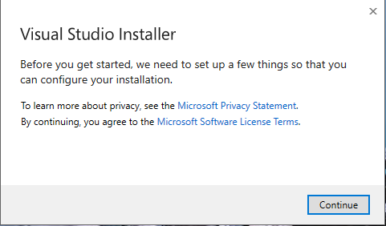
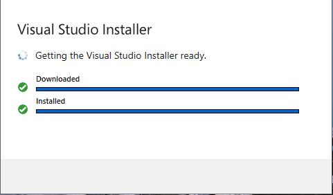
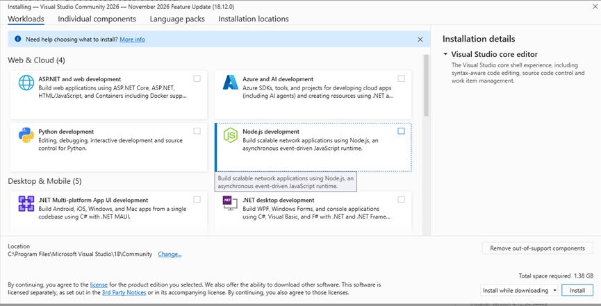
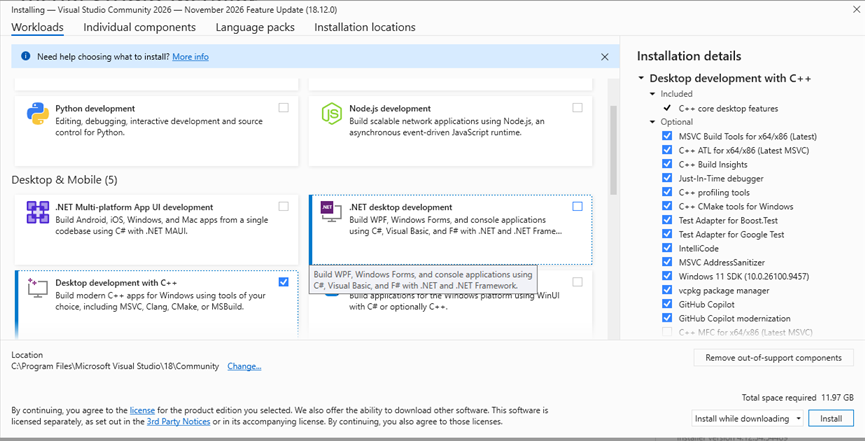

# Installing Visual Studio on a clean Windows, 2026-11-13

The first step of `REV#63` and the clean-machine install `REV#110` asks for.
One Windows Sandbox, a Windows 11 with nothing installed, was used for three
things in order. First, the installer *Install the tools* step 1 links to was
opened and walked to the **Workloads** tab, with a screenshot of each screen,
and **Desktop development with C++** was ticked to see what the installer
selects and what size it shows. Then that installer was closed and Visual
Studio Community 2026 was installed unattended from a candidate `.vsconfig`,
timed. Last, the `v0.3.0` starter project was downloaded and taken through
*Get the starter project* steps 1 to 8 in a prompt set up as the x64 Native
Tools Command Prompt sets it up, timed. The install worked and the starter
went from download to a running game in a minute and a half. Nothing was
added to the starter: whether it ships a `.vsconfig` stays the owner's call.

## The machine

- Windows Sandbox on the owner's desktop: Windows `10.0.26100.9974`, 32
  logical processors, 16 GB of memory given to the sandbox, the host's RTX
  5080 through the sandbox's virtual GPU, about 83 GB free on its `C:`.
- Nothing installed: no Visual Studio, no Visual C++ redistributable, no
  Python (`python`, `python3` and `py` are not found, and the sandbox has no
  Store aliases for them), no Git, no `winget`, no PowerShell 7. Windows'
  `curl.exe` and `tar.exe` are there.
- The sandbox runs its logon script as an administrator with UAC turned off
  (`EnableLUA` is 0). So the Windows *Do you want to allow this app to make
  changes to your device?* prompt that a real PC shows when the installer
  starts did not appear, and was not seen.
- The sandbox's disk is slow and its Windows Installer slower (below), so its
  install time is an upper bound for this selection, not a real PC's time.

## The installer's screens before Workloads

The **Free download** button under *Visual Studio Community* on
`visualstudio.microsoft.com/downloads` leads to
`c2rsetup.officeapps.live.com/c2r/downloadVS.aspx?sku=community&channel=Stable&version=VS18`,
which serves `VisualStudioSetup.exe`, 5,996,752 bytes; it downloaded in 3
seconds. (`aka.ms/vs/18/release/vs_community.exe` redirects to Bing; the
`stable` short link gives `vs_Community.exe`.) Opened, it showed, in order:

1. A small *Visual Studio Installer* window, *Preparing:* and a file name,
   with **Cancel**, for about 9 seconds.
2. The licence screen, below: *Before you get started, we need to set up a
   few things so that you can configure your installation.* with links to the
   privacy statement and the licence terms and one button, **Continue**.

   

3. After **Continue**, *Getting the Visual Studio Installer ready.* with
   **Downloaded** and **Installed** bars, for about 22 seconds.

   

4. The installer itself, 37 seconds after the file was opened, on the
   **Workloads** tab of a dialog headed *Installing — Visual Studio Community
   2026 — November 2026 Feature Update (18.12.0)*, with tabs **Workloads**,
   **Individual components**, **Language packs** and **Installation
   locations**. No question about how to configure appeared: that screen is
   for a machine with Visual Studio already on it.

   

The tab opens on *Web & Cloud* (ASP.NET, Azure, Python, Node.js), and
**Desktop development with C++** is not in that first view: it is the third
tile of *Desktop & Mobile*, under *.NET Multi-platform App UI development*,
reached by scrolling the list down. With nothing ticked the footer says
*Total space required 1.38 GB*. Ticking the workload fills **Installation
details** on the right with *Desktop development with C++*, *Included: C++
core desktop features* and an *Optional* list whose ticked items are, in
order, MSVC Build Tools for x64/x86 (Latest), C++ ATL for x64/x86 (Latest
MSVC), C++ Build Insights, Just-In-Time debugger, C++ profiling tools, **C++
CMake tools for Windows**, Test Adapter for Boost.Test, Test Adapter for
Google Test, IntelliCode, MSVC AddressSanitizer, **Windows 11 SDK
(10.0.26100.9457)**, **vcpkg package manager**, GitHub Copilot and GitHub
Copilot modernization; C++ MFC is the first unticked one. The footer then says
*Total space required 11.97 GB*, beside a drop-down reading **Install while
downloading** and the **Install** button. There was no *Start after
installation* box on this screen.



The walk clicked **Continue** and ticked the workload through UI Automation
inside the sandbox, then closed the installer without clicking **Install**.
So what the interactive installer does when it finishes, including whether
Visual Studio opens itself afterwards (`tools-6`), was not observed.

## The unattended install

The candidate configuration names the workload and what *Install the tools*
asks the reader to check, plus the compiler, which the page says the workload
brings and which the installer lists as an optional, ticked item:

```json
{
  "version": "1.0",
  "components": [
    "Microsoft.VisualStudio.Workload.NativeDesktop",
    "Microsoft.VisualStudio.Component.VC.Tools.x86.x64",
    "Microsoft.VisualStudio.Component.VC.CMake.Project",
    "Microsoft.VisualStudio.Component.Vcpkg",
    "Microsoft.VisualStudio.Component.Windows11SDK.26100"
  ]
}
```

It is smaller than the interactive default above, which adds ATL, the test
adapters, AddressSanitizer, Copilot and the rest. The command was the
downloaded bootstrapper's own:

```bat
VisualStudioSetup.exe --passive --wait --norestart --config labrador.vsconfig
```

`--passive` shows the installer's **Installed** tab with progress and asks
nothing. It exited 0. What it took:

| Measure | Value |
|---|---|
| Whole install, start to exit | 206 minutes (20:34 to 00:00) |
| Download | finished within the first 4 minutes; 2,446,618,908 bytes received during the install |
| Visual Studio's own packages | packages 1 to 444 of 458 in about 70 minutes |
| Windows SDK, package 445 | about 134 minutes: its own installer ran 66 MSI packages, each taking 2 minutes |
| Space used on `C:` | 10,531,549,184 bytes, about 10.5 GB (9.8 GiB) |
| `C:\Program Files\Microsoft Visual Studio\18\Community` | 4.81 GB, of which `VC\Tools\MSVC` 1.67 GB |
| `C:\Program Files (x86)\Windows Kits\10` | 1.80 GB |
| `C:\ProgramData\Microsoft\VisualStudio\Packages` | 1.86 GB |
| `C:\Program Files (x86)\Microsoft Visual Studio` (the installer) | 0.19 GB |

The Windows SDK's log shows every one of its MSI packages applied almost
exactly 2 minutes after the previous one, including packages of under 100 KB,
so that time is a fixed wait in the sandbox, not work, and says nothing about
a real PC. The 70 minutes for the rest are also a slow disk's. Microsoft
gives no time, and no real PC was timed. A first-run review attempt on 2026-11-10 had reached package
279 of 515 after 43 minutes when it was stopped, at the same pace.

The installed product is Visual Studio Community 2026 18.12.0
(`18.12.12405.243`). The installer's exported configuration lists
`Microsoft.Component.MSBuild`, `CoreEditor`, `Roslyn.Compiler`,
`TextTemplating`, `VC.CMake.Project`, `VC.CoreIde`, `VC.Redist.14.Latest`,
`VC.Tools.x86.x64`, `Vcpkg`, `Windows11SDK.26100`,
`ComponentGroup.NativeDesktop.Core`, `ComponentGroup.WebToolsExtensions.CMake`
and the `CoreEditor` and `NativeDesktop` workloads. The Start menu got
**x64 Native Tools Command Prompt for VS** in
`Visual Studio 2026\Visual Studio Tools\VC`, the folder *Install the tools*
step 3 names, beside the x86 and cross prompts; **Developer Command Prompt
for VS** and **Developer PowerShell for VS** went into a separate
`Visual Studio\Visual Studio Tools` folder. Nothing started Visual Studio
itself: no `devenv` was running when the install ended.

## The starter route

In a `cmd` that ran Visual Studio's `vcvars64.bat`, which is what the
x64 Native Tools shortcut runs, the boxes of *Install the tools* step 4 and
*Get the starter project* steps 1 to 7 ran as written, the download with
`curl` from the `v0.3.0` release:

| Step | Result | Time |
|---|---|---|
| `vcvars64.bat` | `Visual Studio 2026 Developer Command Prompt v18.12.0`, `Environment initialized for: 'x64'` | 2.3 s |
| Step 4's check | `cmake version 4.3.1-msvc1`, `1.13.2`, `cl.exe` under `MSVC\14.52.37025`, `fxc.exe` under `10.0.26100.0`, `x64`, `VC\vcpkg` | |
| `where git`, `where python`, `where py` | `INFO: Could not find files for the given pattern(s).` each | |
| Download the starter ZIP | 9,265,469 bytes | 1.9 s |
| Extract with `tar` | the eight entries step 3 lists | 0.3 s |
| `cmake --preset x64-debug` | `Configuring done (79.1s)` | 79 s |
| `cmake --build --preset x64-debug` | exit 0 | 6 s |
| `ctest --preset x64-debug` | both passed, `100% tests passed, 0 tests failed out of 2` | 1.9 s |
| `MyGame.exe` | a window titled *Labrador - minimal sample* with *Hello from the engine.* and the hint line | |

All of it took 1 minute 33 seconds, received 395,640,350 bytes and used
1.93 GB of disk: 0.62 GB in `C:\dev` and 1.27 GB in vcpkg's cache under
`%LOCALAPPDATA%\vcpkg`. With no Git on the machine, configure printed `A
suitable version of git was not found` and fetched vcpkg's portable Git, as
the starter page says. It also fetched a CMake 4.4.3 (Visual Studio's is
4.3.1), a PowerShell 7.6.6 and, not named on that page, a 7-Zip 26.03
(`7z2603-x64.exe` and `7zr.exe`).

What else the guide expects and the clean machine lacked: nothing on the
starter route. Python and Git are both absent and neither was needed; the
page's statement that Python is only for the browser build holds. The Visual
C++ redistributable was not installed beforehand; the debug game ran after
the install, whose exported configuration includes `VC.Redist.14.Latest`.

## What this settles

- `REV#110`: the screens before **Workloads** are a file named
  `VisualStudioSetup.exe`, Windows' administrator prompt on a real PC, a
  licence screen with **Continue**, a short *getting ready* window, and the
  **Workloads** tab, on which the C++ workload has to be scrolled to.
  *Install the tools* step 1 now says so, gives the measured size and time,
  and marks where a starter reader is finished. Whether Visual Studio opens
  itself after an interactive install is still not observed; the page now
  says what to do if it does.
- `REV#63`: a one-file configuration and the bootstrapper's own command
  install everything the starter route needs, and nothing the reader has to
  tick. The selection is 10.5 GB on disk and a 2.4 GB download, about 1.5 GB
  less than the 11.97 GB the installer shows for the workload's default
  ticks. Whether the starter or the page offers that file and command is the
  owner's call.

## Not done

- No person walked the installer; UI Automation clicked inside the sandbox.
- The administrator prompt, the interactive install's end and a restart
  request were not seen.
- The time is a sandbox's. No install on real hardware was timed.
- Visual Studio 2022, Windows 10 and an Arm PC were not tried.
