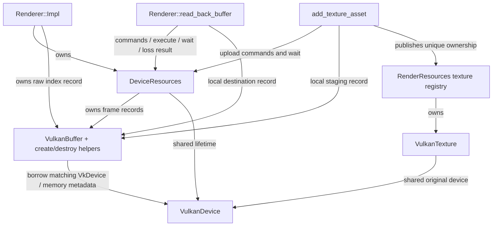

# Vulkan device and buffer ownership review

Source review for [SM-53](../../code-hygiene.md#sm-53-vulkan-devicebuffer-ownership-review),
dated 2026-10-28, against local `15c697907c46c5eb2619081b720751f356232793`.
The Vulkan sources are unchanged by this review. The existing review's
[live tracking](../INDEX.md#vulkan-tracking) remains the owner of device and
platform qualification; this document adds no executed evidence.

**Verdict: keep the current file placement.** `VulkanDevice` and `VulkanBuffer`
form a coherent conceptual boundary, already expressed by named types and
grouped functions. Moving that section alone does not transfer the caller-owned
waits or simplify a competing ownership model. A broader cut would divide the
frame/layout/recovery state machine that must remain coordinated. No extraction
implementation story is proposed. The separate publication and recovery-error
ownership gaps below need bounded follow-ups, rather than a file move.

## Owners and callers

Sources: [device_resources.h](../../../engine/render/vulkan/device_resources.h),
[device_resources.cpp](../../../engine/render/vulkan/device_resources.cpp),
[backend.h](../../../engine/render/vulkan/backend.h),
[renderer.cpp](../../../engine/render/vulkan/renderer.cpp),
[texture_factory.cpp](../../../engine/render/vulkan/texture_factory.cpp) and
[render_resources.cpp](../../../engine/render/vulkan/render_resources.cpp).

| Owner or record | What it owns and what its callers owe |
|---|---|
| `VulkanDevice` | Shared lifetime of the logical device, debug messenger and instance. It also stores selected physical-device/queue handles and memory/alignment/format metadata. The physical-device and queue handles have no separate destruction here. Its destructor performs no wait. |
| `DeviceResources` | Holds a `shared_ptr<VulkanDevice>`, the surface, swapchain and present semaphores, engine colour image/memory/view/framebuffer, render pass, timeline, upload pool and per-frame pools/buffers. It coordinates waits, recording state, layouts, presentation and generation replacement. |
| `DeviceResources::Frame` | Contains the vertex/transform buffer records, descriptor pools, command pool/buffer, acquire semaphore and submitted timeline target for one reusable slot. `reserve_vertices()` and `reserve_transforms()` replace storage after the caller's slot wait; they do not wait themselves. |
| `VulkanBuffer` | A copyable raw record of a buffer, memory, byte capacity and optional persistent mapping. It has neither a destructor nor a retained device reference. Every caller must release it with the matching device after the relevant use finishes. |
| `Renderer::Impl` | Owns `DeviceResources` as its first member, CPU view recordings, pipeline/layout/samplers and the static index buffer. Its destructor waits before releasing its device-dependent resources; the `DeviceResources` member is destroyed last. |
| `RenderResources::Impl` / `VulkanTexture` | The registry owns each texture by `unique_ptr`. Each texture retains its original `VulkanDevice` by `shared_ptr`, so destroying a texture after its renderer can still use the device that made its image. The texture releases view, image and memory in that order before its shared owner is released. |
| Upload/read-back callers | Index creation and texture loading use local staging buffers. Read-back creates a local host-visible destination. These locals use the same raw buffer helpers, but command recording, completion and generation decisions stay with their callers and `DeviceResources`. |

The call graph has no allocator service or dependency back toward the neutral
renderer seam:



`VulkanBuffer` does not itself extend device lifetime: the graph's buffer-to-device
edge is a caller obligation, not a `shared_ptr`. Draw workers record CPU vectors;
the Vulkan submission and allocation paths operate through the coordinating
renderer/device-resources path. Shared device lifetime does not add queue or
buffer-mutation synchronization.

## Destruction and recovery order

1. `Renderer::Impl::~Impl()` calls `try_wait_for_gpu()` and then destroys its
   index buffer, pipeline, layouts and samplers. The cleanup function contains
   no wait, so the device-loss callback can use it after its own earlier wait.
2. `DeviceResources::~DeviceResources()` attempts the timeline wait and then
   `vkDeviceWaitIdle()` before calling `destroy_device_objects()`. These teardown
   paths ignore wait failure rather than throwing from destructors; that source
   behavior is not proof that every failed wait completed work.
3. `destroy_device_objects()` releases swapchain resources, the colour target
   and frame resources, then render pass, upload pool, timeline and surface. The
   colour target releases framebuffer, image view, image and memory in order.
   Frame cleanup releases descriptor pools, vertex/transform buffers, acquire
   semaphore and command pool; the pool owns its command buffer.
4. The surface is destroyed while the instance-owning shared reference still
   exists. `owner_.reset()` then drops this object's device reference. Retained
   textures can keep that generation alive beyond the renderer.
5. The last `VulkanDevice` reference destroys logical device, debug messenger
   and instance, in that order. Its destructor does not take over completion
   responsibility from the coordinating callers.

`handle_device_lost()` attempts device idle before notifying the renderer. The
renderer releases its device resources and forwards the seam notification, which
allows content to release old textures. `DeviceResources` then destroys its
objects, replaces the generation, recreates device/window resources, and calls
the restored notification. `Renderer::Impl::on_device_restored()` recreates its
pipeline/index resources before forwarding restoration to the client.

The paired `colour_layout_` / `colour_layout_submitted_` values, `recording_`,
`submitted_`, frame targets and frame index belong to that same coordination.
`execute()` publishes timeline/layout facts only after a successful queue
submission. `abandon_commands()` discards recording and restores the submitted
layout. `commands()` may wait/reset before reopening a previously submitted
slot. Presentation adds acquired/presentable binary semaphores and stronger
swapchain-idle requirements. These operations are not independent file-splitting
units.

## Allocation and failure cleanup

| Path | Source-established cleanup and limitation |
|---|---|
| `create_vulkan_buffer()` | After successful buffer creation, its `try` covers memory-type selection, allocation, binding and mapping. Memory/mapping outputs enter the cleanup record only after their calls succeed. An exception destroys the partial record with the original device and rethrows. |
| `destroy_vulkan_buffer()` | Unmaps, destroys the buffer, frees memory and clears fields. With a null device it clears the record only. It performs no wait and cannot select a device generation for the caller. |
| Frame growth | The old allocation is destroyed before its replacement is created. A replacement failure therefore does not roll back to the previous allocation. This is current behavior, not a strong transaction guarantee to invent during extraction. |
| Device/target construction | Successful persistent handles are kept in owning members for later teardown if creation throws. The creation methods do not promise transactional rollback or a reusable fully initialized renderer after failure. This review does not inject failed Vulkan creation outputs. |
| `begin_upload()` / `end_upload()` | Begin failure after allocation frees the command buffer. End-recording failure and submit failure also free it; timeline advancement follows successful submission. The post-submit wait has success and catch cleanup paths. Upload completion policy remains in `DeviceResources`, not the raw buffer helper. |
| Index staging | The renderer releases its local staging record on both success and exceptions through upload recording/submission/wait. The persistent index record remains renderer-owned for device-resource cleanup. |
| Texture preparation | The image/staging `try` covers memory selection/allocation/binding, staging creation/copy/upload and view creation. Its catch attempts a non-throwing queue wait and releases the partial handles. The final publication boundary has the separate gap below. |
| Read-back | Success and the catch call `destroy_vulkan_buffer(device_resources.device(), readback)`. If `execute()` returns false after generation replacement, the explicit lost branch instead declines to read the old mapping or destroy its handles through the replacement device, then throws. Exceptions during replacement itself require the separate generation check below. |

These are control-flow and ownership facts. No allocator/API failure was
injected, no pending submission was observed and no cleanup path was executed
for this review. Existing normal-path and bounded instrumented observations stay
in their original [tracking records](../INDEX.md#vulkan-tracking).

## Separate follow-up: texture publication handoff

At this source revision, `add_texture_asset()` ends its raw image/memory/view
cleanup `try/catch` before calling:

```cpp
resources.impl()->add_texture(name,
    std::make_unique<VulkanTexture>(
        device_resources.shared_device(), image, memory, view,
        texture.width, texture.height));
```

If `make_unique` throws `std::bad_alloc` before constructing `VulkanTexture`, no
owning wrapper exists and the earlier cleanup catch is out of scope. The local
raw image, memory and view then have no cleanup owner. This is a source-proven
handoff gap; it is not a reproduced device failure or an allocation-failure
injection result.

Once the wrapper exists, the situation differs: `add_texture()` takes its
`unique_ptr` by value and [Registry::add()](../../../engine/core/registry.h) takes
the storage by value. Insertion exceptions retain owning destruction, and the
registry removes a newly inserted name if adding its vector entry fails. The
missing protection is before wrapper construction, not the registry's existing
insertion rollback.

A bounded follow-up should retain ownership of all three raw handles through
wrapper construction and transfer exactly once before registry publication.
It should preserve the original exception and avoid double cleanup after the
`unique_ptr` takes ownership. This is independent of the keep verdict and
requires a separately scoped implementation/verification record.

## Separate follow-up: read-back generation on recovery exception

The read-back catch assumes its current device is still the one that made the
local buffer. `lost = !device_resources.execute()` distinguishes a normal false
return after recovery, but `execute()` calls `handle_device_lost()` before it
returns. That recovery path contains throwing creation and restoration calls.
An exception after replacement-device creation can therefore reach the catch
before `lost` is assigned, while the catch looks up the current device rather
than retaining the original generation. `create_frames()`, later render/target
creation and the restoration callback supply throwing points after logical
device creation. No enclosing recovery guard changes that ordering.

The catch can consequently pass the replacement device together with the old
buffer, allocation and mapping to `destroy_vulkan_buffer()`. A failure before
logical-device creation can instead reach the null-device clearing branch;
that does not protect the post-creation case. This is source-confirmed error-path
ordering, not an injected or observed device failure. A separate fix must retain
or explicitly distinguish the creating generation while preserving the original
recovery exception. The successful-recovery lost branch alone does not establish
exception-path safety.

## Why keep, and what would justify a later cut

A possible cut would move `VulkanDevice`, `VulkanBuffer`, memory selection and
buffer create/destroy into a backend-private owner module. The error translation
helpers would need a deliberate home so the new module does not include the
larger `DeviceResources` header in reverse. Header ordering also matters:
`device_resources.h` currently defines `VK_USE_PLATFORM_WIN32_KHR` before the
Vulkan header; including a new owner header's Vulkan declarations first must not
silently hide the Win32 surface declarations.

That cut is possible, but no new caller currently requires an independent
allocation interface, no duplicated owner is removed, and it does not solve
the confirmed handoff/generation gaps. The existing named types expose the distinct
lifetimes without moving waits into destructors, adding shared ownership to raw
buffers or separating growth from frame-slot reuse. File length alone does not
justify the extra module and include/error-helper coordination under
[Conventions](../../design/CONVENTIONS.md#files).

Revisit placement when a concrete caller or port needs that independently
consumable owner boundary, or allocation policy develops a second responsibility.
Do not extend such a cut into `commands()` / `execute()` / `abandon_commands()` /
`present()` or their tracked layout/timeline state.

Any later render-source extraction or handoff fix must state its allocation and
generation contracts, enumerate new sources, run the required five-backend
checks and Vulkan upload/pending-submission regressions, and repeat the Vulkan
review's [section-2 synchronization validation](README.md#2-what-was-run-and-what-the-layers-said)
with `validate_sync` and shell-visible output. Those checks were not run here;
the review makes no device, validation, performance or platform-support claim.
